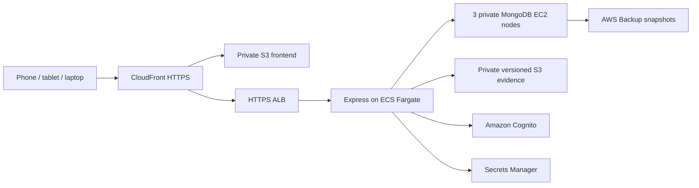

# AWS deployment

The CDK TypeScript stack in `infra/` prepares account-owned MERN hosting. It requires account-specific deployment and operational validation; local synthesis alone does not verify AWS behavior.

## Architecture



CloudFront forwards `/api/*` with caching disabled and preserves cookies, Origin and OAuth query parameters. A secret origin header is checked by Express. The frontend bucket uses Origin Access Control. The browser uses a single HTTPS CloudFront origin and secure HTTP-only cookies. Cognito sign-in uses authorization code, PKCE, verified ID tokens and one-time server-side state.

The ALB certificate is created for `api.<domain>` in the application region. A separate `HayaEdgeStack` issues the CloudFront certificate for `app.<domain>` in `us-east-1`, enforcing a TLS 1.2 minimum. Both use DNS validation. API tasks and MongoDB have private IPs. Database ingress permits only replica peers and the ECS task security group; no SSH port is opened. Administration uses SSM. MongoDB requires TLS, keyfile replica authentication and a restricted application database user. Disks are encrypted.

## Prerequisites

1. Choose the AWS account, region, owner email, sizing, availability, budget and recovery targets. `ap-south-1` is a configurable default.
2. Install Node.js 24 LTS, AWS CLI v2, Docker Desktop with Linux containers, and PowerShell. Use `aws configure sso`, then `aws sso login` and `aws sts get-caller-identity`.
3. Provide an existing Route 53 public hosted zone in this account. Both `api.<domain>` and `app.<domain>` must be available. The deployment creates their DNS records and certificates, including the frontend certificate in `us-east-1`.
4. Ensure permissions/quotas for CloudFormation/CDK bootstrap, IAM, VPC/NAT, EC2/SSM, ECR/ECS/ALB, S3/CloudFront, Route 53/ACM, Cognito, Secrets Manager, CloudWatch and AWS Backup. CDK presents IAM changes for review.
5. Confirm Cognito invitation/email delivery and use the intended owner email. Do not commit credentials or secret values.

The stack incurs ongoing charges for three database nodes with 100 GB disks, NAT, ALB, two API tasks after activation, backup storage, logs and data transfer. It is not a free-tier stack. The single NAT gateway is an initial cost/availability tradeoff; consider one per AZ for your resilience needs. `t3.small` database nodes are sizing examples that need load testing.

## Deploy

From the repository root:

```powershell
.\scripts\aws\deploy.ps1 `
  -Domain yourcompany.com `
  -HostedZoneId Z0123456789ABC `
  -OwnerEmail owner@yourcompany.com `
  -Region ap-south-1
```

The script installs locked dependencies, tests/builds the app, bootstraps CDK and deploys with zero API tasks. Non-secret outputs are saved in ignored `aws-outputs.json`. It then runs the MongoDB bootstrap through SSM, builds/pushes a versioned Linux API image, deploys two healthy API tasks, uploads frontend assets and invites the bootstrap owner through Cognito.

During database bootstrap the first node generates a private CA, a **365-day server certificate** and replica key. Secrets are written directly from EC2 into Secrets Manager, without passing through the deployment terminal. The CA signing key is retained only in the cluster secret for controlled renewal; API tasks receive the public CA and application URI only. The helper starts three TLS-only MongoDB 8.0 containers, initialises `rs0` and creates separate root and application users. The app user has `readWrite` only on `haya`.

Hashed frontend assets use immutable caching. `index.html` is uploaded last with no-cache headers. The deployment invalidates entry files and retains previous frontend object versions. The script prints the actual application URL after successful deployment; check the owner email for the Cognito invitation.

Wait for CloudFront, DNS/certificate validation and SSM registration. On failure, inspect the reported CloudFormation, ECS or SSM operation before retrying. Never reset/delete database volumes as a repair. If root-user creation succeeded but application-user creation or the initialisation marker did not, use authenticated SSM administration to complete recovery; blind reruns are intentionally not a recovery workflow.

## Updates and rollback

Keep the original `aws-outputs.json`, then deploy updates with:

```powershell
.\scripts\aws\deploy.ps1 -Domain yourcompany.com -HostedZoneId Z0123456789ABC -OwnerEmail owner@yourcompany.com -Region ap-south-1 -SkipDatabaseBootstrap
```

This preserves the database and TLS material. Record the deployed Git revision and ECR image tag. ECS uses a deployment circuit breaker; restore a matching S3 `index.html` version and invalidate it for frontend rollback. Incompatible data changes require an explicit migration/rollback plan.

## Production acceptance gates

- Approve the 74 source activities, labels, engineering quantities/units, dependencies, allocations and acceptance/evidence rules. Site plans currently use proposed defaults. Actual site centres, attendance policies and retention remain to be configured; every current visit follows exception review.
- Smoke-test owner project/site creation, Cognito invitations/first-password changes/recovery, manager/supervisor assignments and client-only progress. Verify cross-site API denial, client media denial and secure session expiry. Add access revocation/session administration UI before broader rollout.
- Upload real test evidence, submit work and concurrently retry approval. Confirm one credit, separate quality deductions, correction/reinspection and owner review of manager attendance exceptions. Test a real phone and weak connectivity.
- Confirm all replica members are healthy and primary failover preserves writes. The initial atomic workspace document has MongoDB’s 16 MB limit; split into transaction-backed collections before portfolio growth.
- Confirm scheduled AWS Backup jobs succeed, then **restore into an isolated environment** and verify MongoDB integrity and measured recovery time. EC2 snapshots are infrastructure backups, not tested MongoDB point-in-time recovery. Add application-consistent logical backups/PITR if required by the agreed RPO.
- Establish certificate/key rotation **before the 365-day certificate expires**. Bootstrap TLS material is shared across nodes; automated rotation and individual node certificates are operational follow-up. Rotate passwords through attributed maintenance and roll ECS tasks after secret changes.
- Configure actionable alerts for API errors/latency, restarts, failed backups, disk capacity, replica health and expiring certificates. The stack supplies logs and CPU scaling; alert routing and database metrics still need configuration.
- Agree evidence/audit/attendance retention, export controls, log permissions, data residency, storage lifecycle and restore-drill cadence. Add media scanning/re-encoding and perform an external security review.
- Keep commissioning documents and final acceptance gated until the remaining engineering/handover workflows are implemented. This release is not the full production MVP in the brief.

## Retention

Database instances/disks, S3 buckets, ECR, Cognito and the backup vault retain data across stack removal. Deleting the stack is not a complete teardown and can be blocked by retained-resource dependencies. Retained resources continue to incur charges. Decommission only with a separately reviewed backup/export/removal plan; do not use `cdk destroy` to repair deployment errors.

## References

- [CloudFront origin request policies](https://docs.aws.amazon.com/AmazonCloudFront/latest/DeveloperGuide/using-managed-origin-request-policies.html)
- [Cognito app-client OAuth and callback settings](https://docs.aws.amazon.com/AWSCloudFormation/latest/TemplateReference/aws-resource-cognito-userpoolclient.html)
- [MongoDB TLS client-certificate configuration](https://www.mongodb.com/docs/v8.0/reference/configuration-options/#mongodb-setting-net.tls.allowConnectionsWithoutCertificates)

Dependency review: the application dependencies currently report no npm advisories. The pinned AWS CDK development package bundles a `minimatch` version affected by [GHSA-g3hv-75wg-m249](https://github.com/advisories/GHSA-g3hv-75wg-m249), reported as moderate. It is used by the deployment tooling, not shipped in the application image. Run `npm audit` in `infra/` before deployment and update CDK when an upstream patched bundle is available; do not process untrusted glob patterns in deployment tooling.
